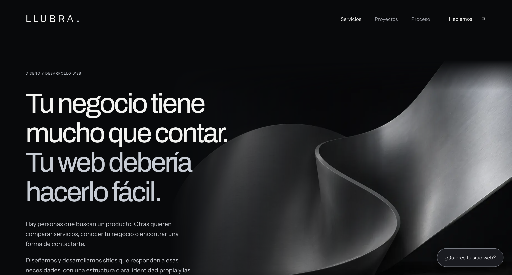
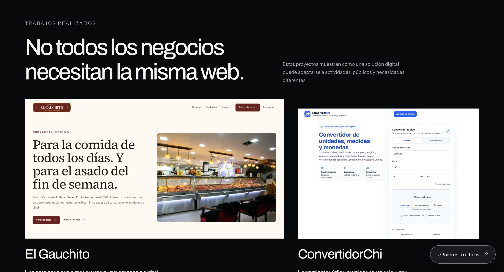
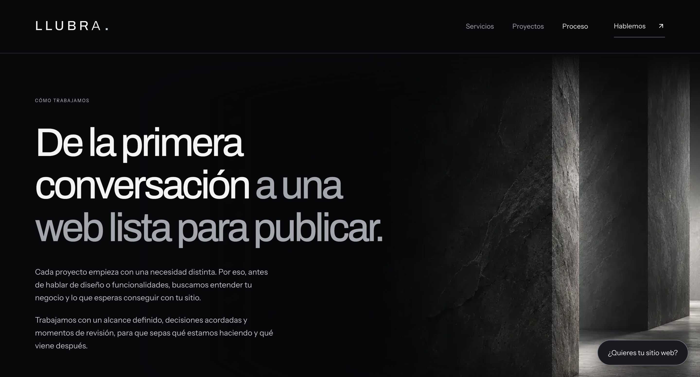

# LLUBRA — Case Study

Independent web design and development studio based in Chile, serving businesses in Chile and Latin America.

**Live website:** [llubra.com](https://llubra.com)

## Project Overview

LLUBRA is my independent web studio, created to provide businesses with professional websites and custom web solutions.

The goal was to build a distinctive, accessible and production-ready studio website that clearly presents services, demonstrates selected work and provides straightforward ways for prospective clients to make contact.

The visual direction combines a dark minimalist aesthetic, expressive typography and responsive layouts.

## Screenshots

### Home

### Services

### Projects

### Work Process

## My Role

I manage the project end to end, including:

- website architecture
- UX and visual design
- frontend and backend development
- content structure
- responsive implementation
- accessibility
- technical SEO
- contact form integration
- testing and deployment
- production maintenance

## Tech Stack

- Next.js
- React
- TypeScript
- Tailwind CSS
- Vercel

## Key Features

- responsive studio website
- presentation of web development services
- selected project portfolio
- work process information
- protected contact form
- WhatsApp contact option
- technical SEO foundations
- accessibility-focused navigation and forms

## Contact and Security

The contact flow includes server-side validation, Cloudflare Turnstile verification and rate limiting to reduce automated submissions and abuse.

The implementation integrates email delivery through Resend.

## Source Code

The production source code is maintained in a private repository.

This public repository documents the project without exposing application source code, credentials or internal configuration.

## Live Project

[https://llubra.com](https://llubra.com)
