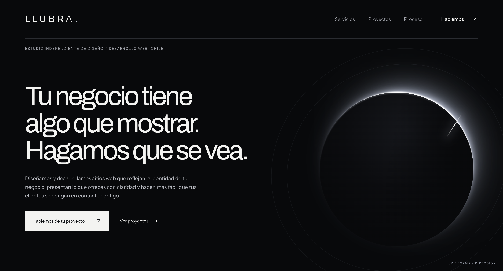

# LLUBRA — Web Design & Development Studio | Case Study

LLUBRA is an independent web design and development studio based in Chile, focused on creating distinctive, accessible and production-ready websites for businesses in Chile and Latin America.

**Live website:** [llubra.com](https://llubra.com)

## Project Overview

The objective was to create a professional digital presence for an independent web studio — a website that communicates its services, demonstrates real projects, explains the development process and provides a reliable way for potential clients to get in touch.

The design combines expressive typography, a dark editorial aesthetic, original visual compositions and responsive layouts.

Beyond its visual identity, LLUBRA was developed as a production application with server-side contact processing, technical SEO, privacy-conscious analytics and automated quality checks.

The project balances three priorities:

- **Visual identity:** a distinctive presentation that reflects the studio's design approach.
- **Usability:** clear navigation, accessible interactions and straightforward paths to contact.
- **Engineering quality:** maintainable architecture, validated user input, performance optimization and controlled production releases.

## Screenshots

### Home

### Services

### Projects

### Work Process

## My Role

I manage the project end to end, covering:

- Product planning and website architecture
- UX and visual design
- Frontend and backend development
- Responsive implementation and accessibility
- Content structure and technical SEO
- Contact form integration and security
- Analytics and consent management
- Testing, deployment and production maintenance

The work includes both the visual presentation and the supporting engineering infrastructure.

## Technology Stack

| Technology | Purpose |
| --- | --- |
| Next.js | App Router, rendering, routing, metadata and server-side processing |
| React | Reusable interfaces and interactive components |
| TypeScript | Typed application logic and data contracts |
| Tailwind CSS and custom CSS | Styling foundation and centralized visual design system |
| Vercel | Hosting and controlled production deployment |
| Cloudflare Turnstile | Bot verification for contact submissions |
| Resend | Email delivery integration |
| Google Analytics 4 | Consent-based website measurement |
| Playwright | Browser, API and server-level automated testing |

## Architecture and Technical Implementation

### Server and Client Components

LLUBRA uses the Next.js App Router with a deliberate separation between presentation and interactive behavior.

Stable marketing pages are designed for prerendering, while request-dependent functionality, including contact processing, runs on the server.

Interactive Client Components are used where necessary for navigation, contact interactions, consent preferences and interface controls.

This approach keeps editorial content suitable for static delivery without moving sensitive processing into the browser.

### Reusable Components

The application uses shared components for navigation, visual presentation, actions and forms.

The contact page and contact modal reuse the same form and controller, with submissions handled by a common server endpoint.

This avoids duplicated submission logic and helps maintain consistent validation feedback and interaction behavior across both entry points.

### Responsive Design System

The visual system combines Tailwind CSS with custom CSS, shared design tokens, fluid typography and responsive layout rules.

Individual pages retain distinctive compositions while sharing consistent spacing, control geometry, typography and interaction patterns.

Original visual artwork and responsive assets contribute to the studio's visual identity.

## Engineering Challenges and Solutions

### 1. Consistent Contact Experiences

**Challenge:** Providing both a dedicated contact page and a modal without creating separate form implementations.

**Solution:** A shared controller, form component and server-side handler manage both contact experiences.

**Result:** Field behavior, validation feedback and submission states remain consistent across the application.

### 2. Reliable Form Feedback

**Challenge:** Handling asynchronous submissions and email-provider failures without losing user input or displaying misleading success messages.

**Solution:** The form preserves entered data during recoverable errors, prevents concurrent submissions and provides explicit pending, error and retry states.

Success is displayed only after the email provider confirms acceptance of the request.

**Result:** Users receive feedback based on the actual submission outcome rather than an assumed successful delivery.

### 3. Privacy-Conscious Analytics

**Challenge:** Measuring website navigation and contact interactions without loading analytics before user consent or collecting inquiry contents.

**Solution:** Analytics loads after explicit consent, with sanitized pageview information, duplicate-event prevention and a minimal lead event triggered after accepted submissions.

**Result:** Measurement is separated from form content, and analytics failures do not interfere with contact submission feedback.

### 4. Production and Preview SEO Separation

**Challenge:** Preventing noncanonical deployment environments from introducing duplicate indexable pages.

**Solution:** Environment-aware metadata, canonical URLs, robots directives, sitemap generation and HTTP indexing controls distinguish the public production website from Preview environments.

**Result:** Production pages provide consistent canonical signals while Preview deployments remain restricted from search indexing.

## Contact Form and Security

LLUBRA provides a dedicated contact page and a reusable contact modal, both supported by shared form components and server-side processing.

The contact system includes input validation, bot verification, abuse prevention and email delivery through a protected server-side workflow.

User feedback is designed to handle submission errors, prevent duplicate requests and preserve entered information when retrying.

Security-sensitive implementation details and operational configurations are intentionally excluded from this public case study.

## SEO and Analytics

LLUBRA includes technical SEO foundations implemented directly in the application:

- Page-specific titles and descriptions
- Canonical URLs
- Production XML sitemap
- Environment-aware robots directives
- Organization and WebSite structured data
- Open Graph and social sharing metadata
- Semantic HTML and accessible navigation
- Internal links between primary website sections

Google Analytics 4 uses an explicit consent mechanism.

Visitors can accept, reject or revisit their analytics preferences. Measurement avoids including contact form values in events and is disabled when consent is withdrawn.

Google Search Console is used for monitoring search visibility and indexing.

## Performance and Accessibility

The implementation includes:

- Prerendering of suitable marketing pages
- Separation of interactive Client Components
- Locally hosted fonts
- Responsive image assets
- Optimized portfolio image rendering
- Reduced-motion support
- Keyboard-accessible navigation
- Accessible form labels and error feedback
- Modal focus management

### Recorded Lighthouse Results

Retained Lighthouse 13.6.0 reports from November 24, 2026 cover five public pages in mobile and desktop configurations.

| Page | Mobile Performance | Desktop Performance |
| --- | ---: | ---: |
| Home | 99 | 100 |
| Services | 99 | 100 |
| Process | 99 | 100 |
| Contact | 100 | 100 |
| Privacy | 100 | 100 |

All five pages recorded **100/100 for Accessibility, Best Practices and SEO** in both configurations.

These are dated laboratory results. They precede subsequent minor application releases and do not represent continuous monitoring, real-user Core Web Vitals or a claim of full WCAG conformance.

## Testing and Quality Assurance

Automated testing uses Playwright across browser, HTTP and isolated server scenarios.

Test coverage includes:

- Contact input validation and failure handling
- Email-domain validation
- Contact form feedback and interaction behavior
- Navigation and responsive interfaces
- Canonical metadata, sitemap and robots directives
- Analytics consent, event sanitization and preference withdrawal

The project also provides scripts for TypeScript checks, ESLint, formatting verification and production builds.

During the November 24, 2026 technical audit, ESLint, TypeScript validation and selected server-side assertions passed.

A complete browser suite and new production build were not executed as part of that read-only audit.

Production releases follow a controlled deployment process rather than an automated GitHub Actions CI/CD pipeline.

## Project Outcomes

The project delivers:

- A production studio website with five public pages
- A consistent visual identity and responsive design system
- A portfolio showcasing real web projects
- A protected contact flow available through two entry points
- Technical SEO with production-aware indexing controls
- Consent-based analytics
- Automated test coverage and documented quality checks
- Recorded high Lighthouse laboratory scores

The architecture supports ongoing development through reusable components, typed application logic and centralized design and metadata configuration.

Commercial outcomes such as revenue growth, lead conversion rates or organic ranking improvements are not claimed without supporting measurements.

## Source Code

The production application is maintained in a private repository.

This public repository documents the design, functionality and engineering decisions without exposing proprietary source code, credentials or internal infrastructure configuration.

## Live Project

**Website:** [https://llubra.com](https://llubra.com)
